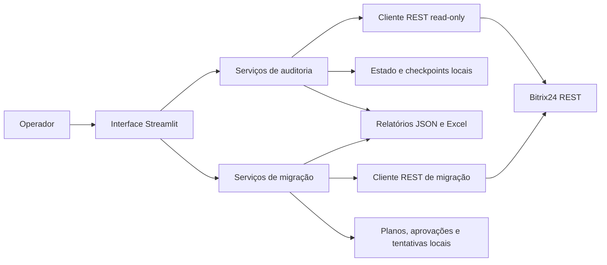
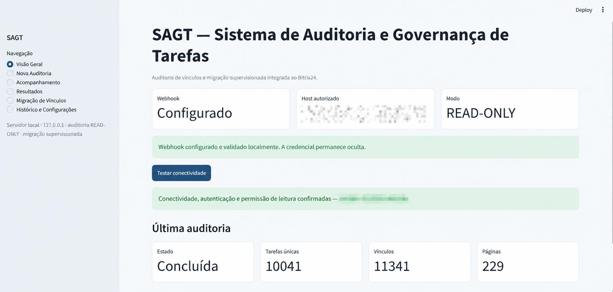
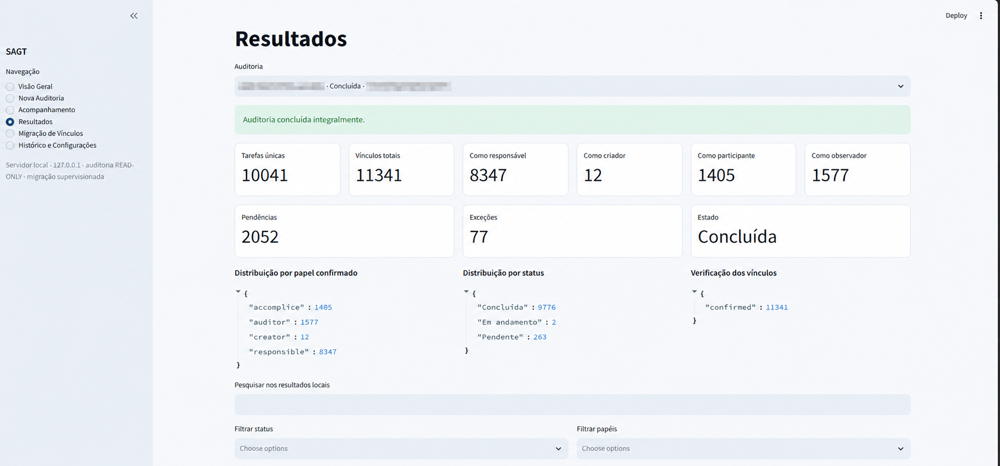
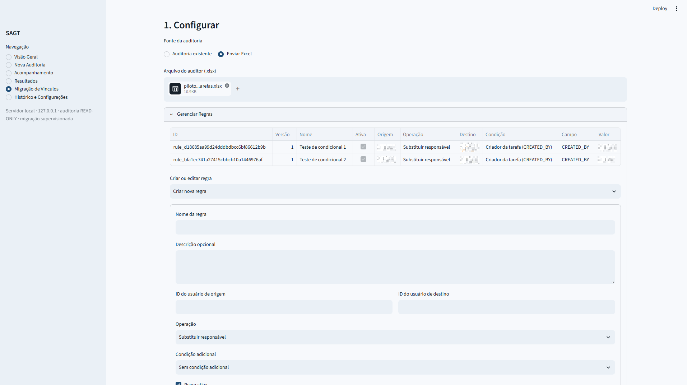
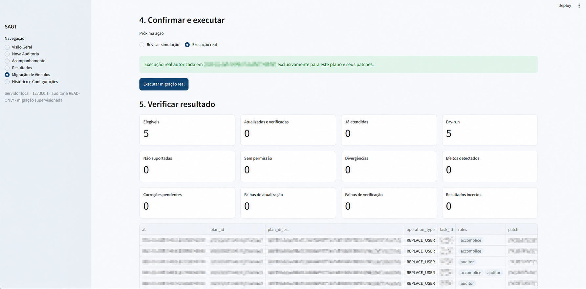

# SAGT — Sistema de Auditoria e Governança de Tarefas

Python • Streamlit • Bitrix24 REST • Auditoria • Governança operacional

Sistema de auditoria e governança de tarefas integrado ao Bitrix24, com rastreabilidade de vínculos, automação de processos operacionais e migração supervisionada de responsabilidades.

[Sobre](#sobre-o-projeto) · [Problema](#problema-que-resolve) · [Arquitetura](#arquitetura) · [Funcionalidades](#funcionalidades) · [Segurança](#segurança-e-integridade) · [Demonstração](#demonstração) · [Instalação](#instalação-e-execução) · [Documentação](#documentação-complementar) · [Confidencialidade](#confidencialidade)

---

## Sobre o projeto

O SAGT foi desenvolvido para apoiar a análise e a regularização de vínculos em tarefas do Bitrix24. A aplicação combina uma interface Streamlit, um cliente REST com métodos permitidos explicitamente, persistência local de execuções e exportação de relatórios em JSON e Excel.

O sistema mantém dois limites operacionais distintos:

- auditoria somente leitura, para coletar tarefas e consolidar responsáveis, criadores, participantes e observadores;
- migração supervisionada, para planejar, simular opcionalmente, aprovar e verificar alterações nos papéis suportados.

O código-fonte é executável localmente. Credenciais, dados operacionais, estados de execução e relatórios reais não fazem parte da versão pública.

---

## Problema que resolve

### Rastreabilidade e transparência

Em ambientes com milhares de tarefas, os vínculos podem ficar distribuídos e desatualizados, inclusive para colaboradores desligados ou realocados. Localizar cada ocorrência manualmente dificulta a manutenção das responsabilidades.

O SAGT oferece visibilidade sobre os papéis encontrados em cada tarefa e consolida evidências para análise. As regras implementadas também identificam pendências objetivas, como ausência de responsável, título ou prazo, tarefas vencidas, sem atualização recente e campos personalizados obrigatórios não preenchidos.

### Dependência de processos manuais

Sem automação, a regularização exige localizar tarefas, consultar seus vínculos, conferir colaboradores e alterar campos individualmente. O SAGT automatiza a coleta, a consolidação e a preparação das operações, reduzindo intervenções repetitivas sem substituir a decisão do operador.

### Migração de vínculos em escala

A aplicação processa conjuntos delimitados de tarefas e prepara substituições nos papéis suportados. Isso atende cenários de desligamento, realocação, reorganização de equipes, regularização de vínculos e padronização de responsabilidades.

Toda migração permanece supervisionada: a escrita real depende de validação do plano, aprovação vinculada ao seu digest, liberação ambiental explícita, revalidação antes das alterações e verificação posterior.

### Integridade das alterações

Operações em lote exigem proteção contra planos desatualizados, concorrência e resultados ambíguos. O SAGT relê o estado atual antes da escrita, preserva vínculos fora do escopo, bloqueia execuções divergentes, serializa a execução de cada plano e verifica o estado persistido depois de cada atualização.

Falhas ocorridas depois de uma possível escrita não são repetidas automaticamente. Quando a releitura não comprova o resultado, a operação é registrada para revisão humana.

---

## Arquitetura



| Camada | Responsabilidade |
| --- | --- |
| Interface | Configuração da auditoria, acompanhamento, resultados e fluxo supervisionado de migração |
| Serviços | Orquestração de coleta, análise, pré-validação, execução e verificação |
| Integração REST | Clientes separados para consultas e para a única operação de escrita permitida |
| Auditoria | Normalização de tarefas, vínculos, achados e cobertura das consultas |
| Migração | Planos imutáveis por digest, simulação opcional, aprovação e releitura posterior |
| Persistência | Arquivos locais em `.state/`, com checkpoints, histórico e evidências operacionais |
| Exportação | Relatórios JSON e Excel gravados em `output/` ou no diretório relativo configurado |

[Ver arquitetura detalhada](docs/arquitetura.md)

---

## Funcionalidades

### Auditoria somente leitura

- coleta paginada de tarefas e usuários;
- filtros por colaboradores, papéis, grupos, status, prioridade e prazo;
- identificação de responsável, criador, participante e observador;
- enriquecimento read-only quando a listagem não fornece os campos necessários;
- detecção das pendências objetivas implementadas no motor de auditoria;
- checkpoints, cancelamento cooperativo e retomada;
- consolidação de tarefas, vínculos, achados, usuários, resumo e metadados;
- exportação de relatórios JSON e Excel.

### Migração supervisionada

- seleção de auditoria concluída ou envio do Excel original;
- definição de usuários, papéis e regras de substituição;
- identificação de tarefas elegíveis, divergentes, não suportadas ou sem permissão;
- geração de prévia e digest SHA-256 do plano;
- pré-validação do estado atual e do usuário de destino;
- dry-run opcional, com checkpoint separado da execução real;
- aprovação por frase vinculada ao digest e ao conjunto exato de patches;
- execução condicionada por trava ambiental e autorização do operador;
- releitura e verificação de efeitos após cada escrita;
- registro persistente de tentativas, bloqueios e resultados.

O criador da tarefa é auditável, mas não é migrado. A escrita está restrita a `RESPONSIBLE_ID`, `ACCOMPLICES` e `AUDITORS` pelo método `tasks.task.update`.

[Ver fluxo de auditoria](docs/auditoria.md) · [Ver migração supervisionada](docs/migracao-supervisionada.md)

---

## Segurança e integridade

- o cliente de auditoria aceita somente métodos REST de leitura definidos em allowlist;
- a escrita usa um cliente separado e aceita somente `tasks.task.update` com campos permitidos;
- webhooks exigem HTTPS, formato válido e host presente em `allowed_hosts`;
- credenciais não são persistidas em históricos, modelos ou relatórios;
- a interface escuta em `127.0.0.1`, com CORS e proteção XSRF habilitados;
- nomes e caminhos de saída permanecem dentro do projeto;
- valores potencialmente interpretados como fórmulas são neutralizados no Excel;
- planos de migração usam digest, aprovação exata e locks locais;
- divergências na pré-validação bloqueiam a operação correspondente;
- timeouts depois de uma possível escrita produzem resultado incerto e exigem verificação, sem retry cego.

Esses controles reduzem riscos, mas não eliminam o risco residual de alterações concorrentes no Bitrix24.

[Ver controles de segurança](docs/seguranca.md)

---

## Resultados e impacto operacional

A validação funcional confirmou o fluxo da aplicação em ambiente real. Os dados dessa validação permanecem privados e nenhuma métrica operacional é publicada sem evidência autorizada.

Como capacidade técnica, o SAGT entrega quatro benefícios:

- **Governança e rastreabilidade:** evidencia os vínculos das tarefas e apoia a identificação de inconsistências;
- **Eficiência operacional:** automatiza coleta, consolidação, planejamento e verificação antes realizados de forma repetitiva;
- **Processamento em escala:** trabalha com conjuntos de tarefas, paginação completa, checkpoints e execução em lotes;
- **Segurança e confiabilidade:** condiciona escritas a validações, aprovação e conferência posterior.

---

## Demonstração

As capturas abaixo apresentam os principais fluxos do SAGT. A sequência visual completa de configuração, acompanhamento, inventário, prévia e validação está disponível na documentação técnica de cada frente.

### Auditoria e governança

#### Dashboard



*Visão geral do ambiente local, do modo read-only e do volume consolidado pela auditoria.*

#### Resultados e inventário



*Indicadores de tarefas, vínculos, papéis e cobertura da execução selecionada, com acesso ao inventário consolidado.*

[Ver configuração, acompanhamento, resultados e exportação da auditoria](docs/auditoria.md)

### Migração supervisionada

#### Gerenciador de regras



*Regras configuráveis para delimitar origem, destino, operação e condição adicional.*

#### Validação e autorização



*Autorização vinculada ao plano, execução condicionada e consolidação dos resultados da verificação posterior.*

[Ver regras, prévia, execução e verificação da migração supervisionada](docs/migracao-supervisionada.md)

As capturas preservam os componentes e indicadores funcionais, com anonimização pontual de identificadores rastreáveis. Não são usadas imagens fictícias.

---

## Minha atuação

As contribuições técnicas demonstradas pelo repositório abrangem:

- desenvolvimento da aplicação em Python e Streamlit;
- integração com a API REST do Bitrix24;
- automação dos fluxos de coleta, análise e exportação;
- modelagem dos vínculos e dos fluxos de auditoria;
- implementação de validações e controles de integridade para migrações;
- tratamento de paginação, concorrência e resultados de escrita incertos;
- testes automatizados direcionados e validação funcional;
- documentação técnica e operacional.

---

## Tecnologias utilizadas

| Camada | Tecnologias |
| --- | --- |
| Linguagem | Python 3.11+ |
| Interface | Streamlit |
| Integração | Bitrix24 REST, `urllib` da biblioteca padrão |
| Configuração | TOML, python-dotenv |
| Exportação | openpyxl, JSON |
| Persistência | Arquivos JSON e NDJSON locais |
| Testes | unittest |

---

## Instalação e execução

### Pré-requisitos

- Python 3.11 ou superior;
- Windows com PowerShell ou Prompt de Comando para os inicializadores fornecidos;
- webhook do Bitrix24 com permissões compatíveis com as operações pretendidas;
- acesso ao índice de pacotes Python na primeira instalação.

### 1. Ambiente virtual e dependências

```powershell
python -m venv .venv
.\.venv\Scripts\python.exe -m pip install -r requirements.txt
```

O inicializador `iniciar_auditor.bat` também cria a `.venv` e instala as dependências ausentes automaticamente.

### 2. Configuração local

```powershell
Copy-Item .env.example .env
Copy-Item config/auditor.example.toml config/auditor.toml
```

No `.env`, substitua o placeholder localmente:

```dotenv
BITRIX24_WEBHOOK_URL=https://SEU-PORTAL.bitrix24.com.br/rest/ID/TOKEN/
```

Em `config/auditor.toml`, informe somente o hostname exato do portal:

```toml
[bitrix]
allowed_hosts = ["seu-portal.bitrix24.com.br"]
```

O `.env` e `config/auditor.toml` são arquivos locais ignorados pelo Git. A aplicação carrega o `.env` sem substituir variáveis já definidas no processo.

### 3. Inicialização

```powershell
.\iniciar_auditor.bat
```

Alternativa PowerShell:

```powershell
.\iniciar_auditor.ps1
```

A interface fica disponível em `http://127.0.0.1:8501`.

### 4. Auditoria somente leitura

Na interface:

1. abra **Nova Auditoria**;
2. defina colaboradores, papéis e filtros;
3. revise o resumo e inicie a auditoria read-only;
4. acompanhe o checkpoint em **Acompanhamento**;
5. consulte e exporte o resultado em **Resultados**.

A aplicação não consulta o Bitrix24 ao abrir. Testes de conexão, atualização de catálogo e auditorias dependem de ação explícita.

### 5. Restrições para migrações

Por padrão, a escrita real permanece bloqueada. A simulação é opcional e recomendada para conferência, mas a execução real não depende de sua conclusão. Somente uma operação formalmente autorizada deve iniciar o processo com:

```powershell
$env:BITRIX24_MIGRATION_WRITES_ENABLED = 'YES'
```

Essa variável não substitui a validação do plano, a confirmação explícita, a revalidação antes das alterações nem a verificação posterior. Remova-a ao encerrar:

```powershell
Remove-Item Env:BITRIX24_MIGRATION_WRITES_ENABLED
```

Não execute migrações reais em desenvolvimento, demonstrações ou testes.

### CLI preservado

Validar a configuração sem rede:

```powershell
.\auditor.cmd --config config/auditor.toml validate-config
```

Auditoria offline a partir de dados locais:

```powershell
.\auditor.cmd --config config/auditor.toml audit-file dados-locais.json
```

---

## Documentação complementar

| Documento | Conteúdo |
| --- | --- |
| [Arquitetura](docs/arquitetura.md) | Componentes, responsabilidades, persistência e limites |
| [Auditoria](docs/auditoria.md) | Coleta, vínculos, achados, checkpoints e relatórios |
| [Migração supervisionada](docs/migracao-supervisionada.md) | Planejamento, simulação opcional, aprovação, execução e verificação |
| [Segurança](docs/seguranca.md) | Proteção de credenciais, controles de escrita e publicação segura |
| [Aprendizados](docs/aprendizados.md) | Desafios técnicos e decisões comprovadas no projeto |

---

## Confidencialidade

Este repositório público contém o código-fonte e a documentação técnica do SAGT como case de portfólio. Credenciais, webhooks, configurações privadas, relatórios operacionais, checkpoints, logs e dados de auditorias reais não fazem parte do conteúdo versionado; os exemplos usam apenas placeholders e as capturas publicadas foram anonimizadas.

A publicação do código não implica autorização irrestrita para reutilização ou redistribuição nem concede acesso a ambientes institucionais. A disponibilidade pública do repositório também não substitui eventuais autorizações de titularidade ou distribuição aplicáveis.

---

## Autor

**Gabriel Santos Inácio**

GitHub: [github.com/Gabriel-S-Inacio](https://github.com/Gabriel-S-Inacio)
