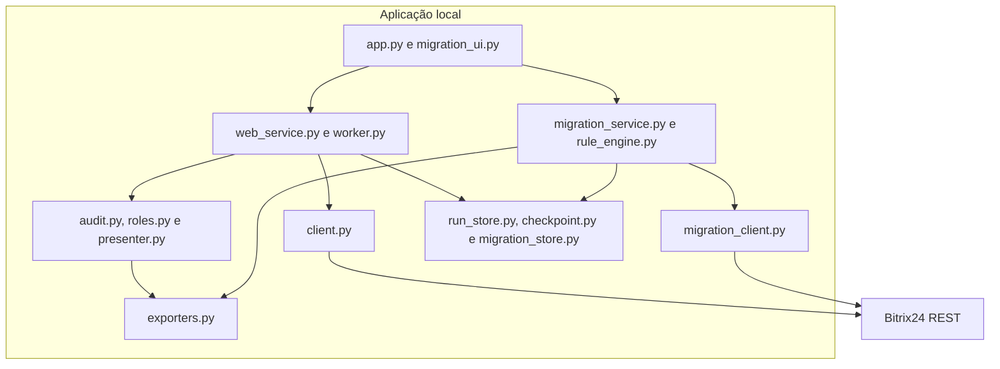

# Arquitetura do SAGT

[Voltar ao README](../README.md)

## Visão geral

O SAGT é uma aplicação local em Python. A interface Streamlit orquestra serviços de auditoria e migração, enquanto clientes REST separados impõem os limites entre leitura e escrita. Não existe banco de dados: estados e relatórios são persistidos em arquivos locais.

## Componentes e responsabilidades

### Interface

`app.py` apresenta visão geral, criação e acompanhamento de auditorias, resultados, migração de vínculos e configuração segura. `migration_ui.py` implementa o fluxo visual de configurar, validar, simular opcionalmente, confirmar, executar e verificar.

A abertura da interface não dispara chamadas ao Bitrix24. Operações de rede dependem de ação explícita.

### Auditoria e serviços web

`web_service.py` valida solicitações, controla a existência de uma auditoria ativa e inicia um worker separado. `worker.py` percorre as unidades de consulta, valida a paginação, enriquece registros quando necessário e atualiza o checkpoint.

`audit.py` aplica regras objetivas aos modelos normalizados. `roles.py` consolida os vínculos por `task_id`, `user_id` e papel. `presenter.py` prepara indicadores e tabelas para a interface.

### Integração REST

`client.py` aceita apenas os métodos read-only definidos em `READ_ONLY_METHODS`. Ele trata paginação, respostas HTTP transitórias e falhas de transporte sem expor o webhook.

`migration_client.py` é independente. As leituras ficam limitadas a `tasks.task.get` e `user.get`; a única escrita aceita é `tasks.task.update`, e o patch só pode conter `RESPONSIBLE_ID`, `ACCOMPLICES` e `AUDITORS`.

### Migração supervisionada

`migration_importer.py` lê o relatório de auditoria sem modificá-lo. `migration_models.py`, `migration_rule_engine.py` e `migration_rules.py` constroem planos simples ou baseados em regras. `migration_service.py` pré-valida, executa e verifica as operações. `migration_store.py` persiste plano, digest, aprovação, checkpoints e tentativas.

### Persistência e exportação

| Local | Conteúdo | Publicação |
| --- | --- | --- |
| `.state/web_runs/` | Estado, spools, heartbeat e log das auditorias | Ignorado |
| `.state/templates/` | Modelos locais de auditoria | Ignorado |
| `.state/migrations/` | Planos, aprovações, tentativas e relatórios de migração | Ignorado |
| `output/` | Relatórios JSON e Excel | Ignorado |
| `config/auditor.toml` | Configuração operacional local | Ignorado |
| `config/auditor.example.toml` | Modelo público sem dados reais | Versionável |

Gravações críticas de estado usam arquivos temporários e substituição atômica. A execução de cada plano de migração usa lock local para evitar concorrência no mesmo plano.

## Limites arquiteturais

- A aplicação foi projetada para execução local e escuta apenas em `127.0.0.1`.
- O estado em arquivos atende ao fluxo local; o sistema não implementa coordenação distribuída.
- O Bitrix24 clássico não oferece compare-and-swap para os campos migrados. Pré-validação e releitura reduzem a janela de risco, mas não eliminam concorrência externa.
- Relatórios e estados podem conter dados operacionais e devem permanecer fora do repositório.
