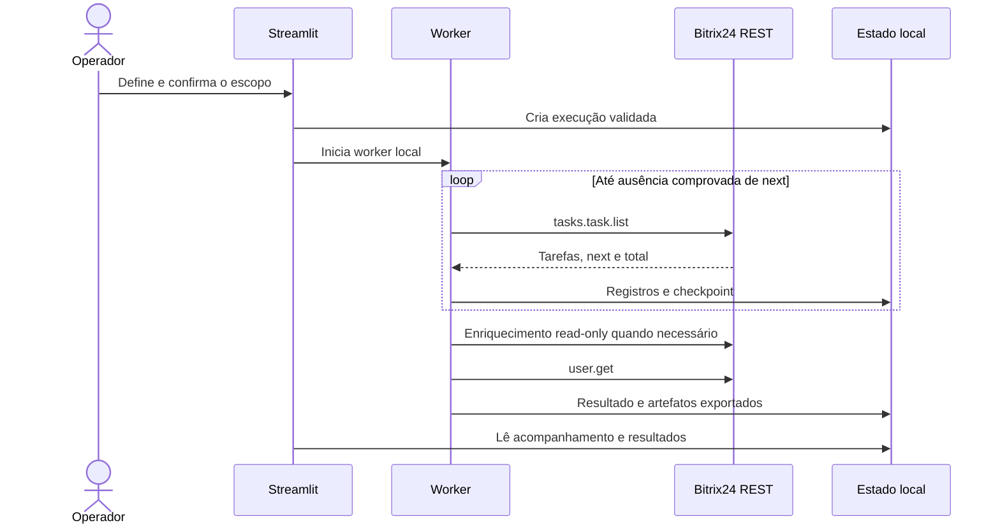
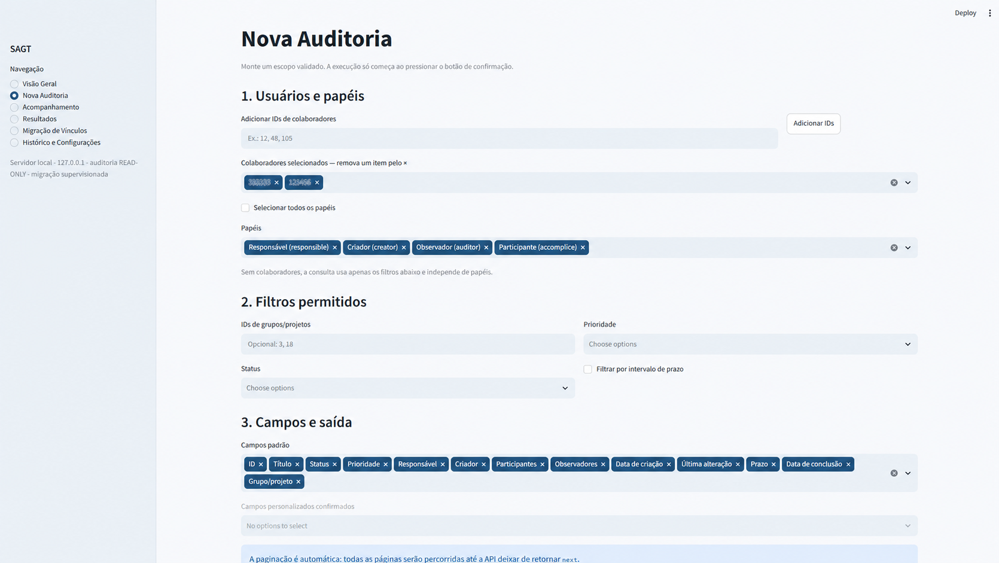
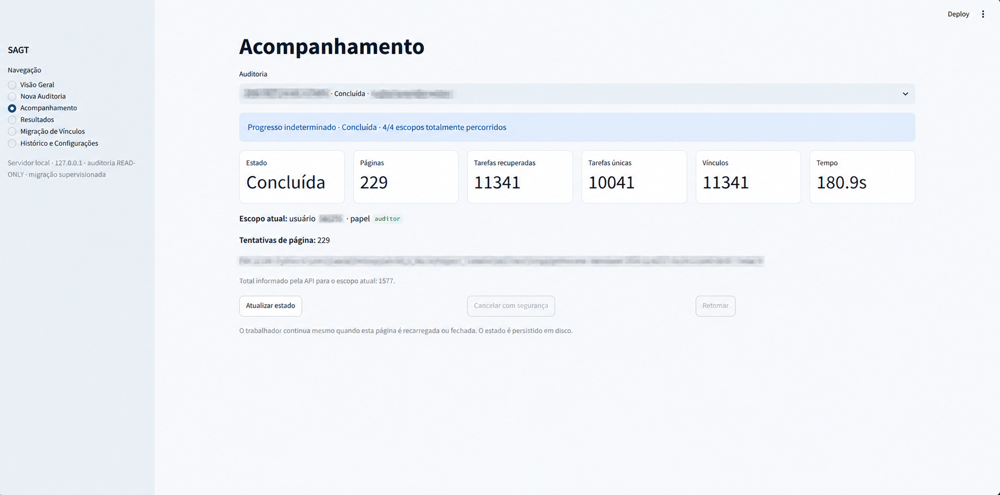
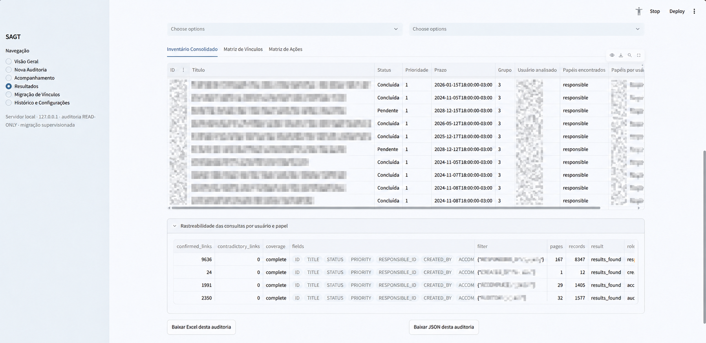

# Auditoria somente leitura

[Voltar ao README](../README.md)

## Objetivo

A auditoria fornece uma visão consolidada das tarefas e de seus vínculos sem executar criações, atualizações ou exclusões no Bitrix24. O escopo pode ser definido por colaboradores e papéis ou apenas pelos filtros permitidos.

## Fluxo operacional

## Documentação visual

### Configuração da auditoria

*O operador delimita colaboradores, papéis, filtros e campos antes de confirmar a coleta read-only.*

### Processamento e acompanhamento

*Estado, paginação, tarefas recuperadas, vínculos e tempo permanecem visíveis sem expor o ambiente local.*

### Inventário e exportação

*A tabela preserva status, prioridades, prazos, papéis, cobertura e opções de exportação; títulos e identificadores foram anonimizados.*

## Métodos REST permitidos

- `user.current` para teste explícito de conectividade;
- `user.get` para dados dos usuários;
- `tasks.task.list` para coleta paginada;
- `tasks.task.get` para enriquecimento de campos ausentes;
- `task.item.userfield.getlist` para o catálogo confirmado de campos personalizados.

O cliente recusa qualquer método fora dessa allowlist.

## Papéis analisados

| Papel no SAGT | Campo Bitrix24 |
| --- | --- |
| Responsável | `RESPONSIBLE_ID` / `responsibleId` |
| Criador | `CREATED_BY` / `createdBy` |
| Participante | `ACCOMPLICES` / `accomplices` |
| Observador | `AUDITORS` / `auditors` |

Quando o campo necessário não é retornado na listagem, o worker tenta confirmá-lo com `tasks.task.get`. Ausência persistente ou contradição produz cobertura parcial e recomendação de avaliação manual; a auditoria não define uma reatribuição automaticamente.

## Achados implementados

O motor atual pode registrar:

- tarefa sem identificador, título, responsável ou prazo;
- tarefa aberta vencida ou próxima do prazo;
- tarefa concluída depois do prazo;
- tarefa aberta sem atualização dentro do intervalo configurado;
- campo personalizado obrigatório não preenchido para um papel configurado.

Esses achados são regras explícitas. O SAGT não classifica automaticamente toda possível violação organizacional.

## Paginação, retomada e cobertura

O cursor `next` é seguido até sua ausência. Uma página curta ou vazia não encerra a coleta quando a API ainda informa o próximo cursor. Cursores repetidos, regressivos ou incompatíveis com `total` interrompem a execução e preservam o que já foi coletado.

O estado não depende apenas da sessão do navegador. Checkpoints e spools permitem acompanhar, cancelar cooperativamente e retomar execuções parciais.

## Relatórios

Cada execução associa seus artefatos ao `run_id`. O JSON registra tarefas, vínculos, achados, ações sugeridas, usuários, resumo e metadados. O Excel organiza o resultado nas abas `Tarefas`, `Vínculos`, `Achados`, `Usuários`, `Resumo` e `Metadados`.

Os relatórios podem conter informações pessoais e operacionais. Eles são locais, ignorados pelo Git e não devem ser usados como exemplos públicos sem anonimização e autorização.
