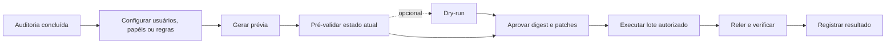
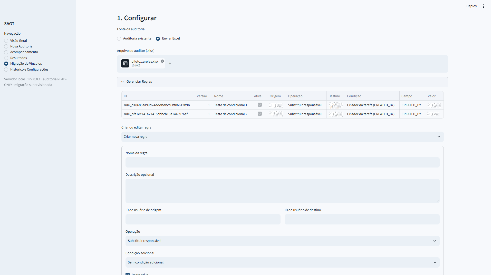
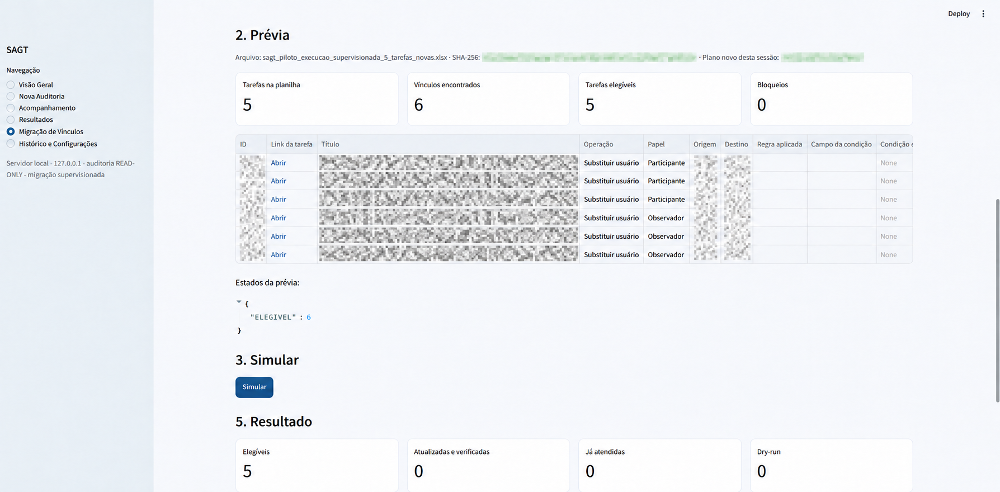
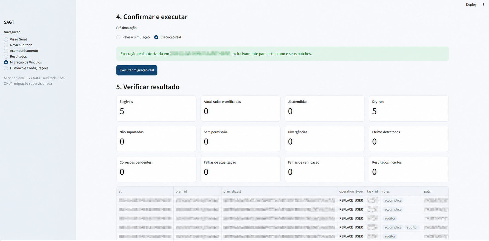

# Migração supervisionada

[Voltar ao README](../README.md)

## Princípio operacional

A migração não é uma extensão automática da auditoria. Ela usa cliente, armazenamento, aprovação e controles próprios. O relatório concluído delimita as tarefas que podem integrar o plano, e o arquivo de entrada não é modificado.

## Papéis e operações suportados

O cliente de migração aceita somente `tasks.task.update` e restringe o patch a:

- `RESPONSIBLE_ID` para responsável;
- `ACCOMPLICES` para participantes;
- `AUDITORS` para observadores.

O criador é apresentado como não suportado para migração. Listas de participantes e observadores são recompostas a partir do estado atual para preservar membros fora do escopo.

## Controles por etapa

### 1. Importação e planejamento

- aceita uma auditoria local ou o Excel original enviado pelo operador;
- valida estrutura, IDs e papéis;
- limita o plano às tarefas comprovadas no artefato;
- permite migração simples e planos baseados em regras implementadas;
- calcula um digest canônico do plano e da prévia.

*Regras ativas combinam origem, destino, operação e condições verificáveis antes da geração da prévia.*

### 2. Pré-validação

- confirma que o usuário de destino está ativo;
- relê cada tarefa elegível;
- compara o estado auditado com o estado atual;
- verifica permissão de edição quando a API fornece essa evidência;
- classifica operações elegíveis, divergentes, já atendidas, não suportadas ou sem permissão;
- invalida a aprovação anterior quando o plano muda.

### 3. Simulação opcional

O dry-run percorre as mesmas operações e revalida o estado, mas não chama o método de escrita. Ele é opcional e seus resultados são armazenados separadamente dos resultados reais. Uma execução real devidamente validada e aprovada não depende da conclusão de uma simulação.

*A prévia apresenta o escopo, os papéis, as operações e os bloqueios antes da confirmação; identificadores e títulos rastreáveis foram anonimizados.*

### 4. Aprovação

A frase de confirmação inclui origem, destino e parte do digest. A aprovação persiste o conjunto exato de tarefas, patches e correções de efeitos colaterais autorizadas. Qualquer alteração relevante muda o digest e invalida essa aprovação.

### 5. Execução real

A escrita depende simultaneamente de:

- plano elegível e pré-validado;
- aprovação exata registrada;
- opção de execução real selecionada na interface;
- `BITRIX24_MIGRATION_WRITES_ENABLED=YES` no processo;
- ausência de outra execução concorrente do mesmo plano.

A variável ambiental é uma trava técnica, não uma autorização suficiente por si só. A validação do plano, a confirmação explícita, a revalidação antes das alterações e a verificação posterior continuam obrigatórias.

### 6. Verificação

Antes de cada escrita, o estado é relido. Depois da resposta, a tarefa é consultada novamente e comparada com o estado esperado. Efeitos colaterais não autorizados bloqueiam a continuidade e podem exigir um plano específico de correção.

Se ocorrer timeout ou falha HTTP 5xx depois de uma possível escrita, o cliente não repete a atualização. Ele tenta verificar o estado; sem comprovação, registra `RESULTADO_INCERTO` para revisão humana.

*A tela mantém os indicadores de elegibilidade, atualização, divergência e verificação, ocultando evidências rastreáveis da execução.*

## Persistência e rastreabilidade

Cada plano possui diretório próprio em `.state/migrations/`, com plano, estado, aprovação, tentativas e relatórios. Os registros distinguem dry-run e execução real e permitem retomar lotes sem tratar uma simulação como escrita concluída.

Esses artefatos podem conter dados operacionais e nunca devem ser publicados.

## Risco residual

O Bitrix24 clássico não fornece compare-and-swap para os campos usados. Uma alteração externa pode ocorrer entre a pré-validação e a escrita. A releitura imediata reduz essa janela, mas operações reais ainda exigem supervisão e lotes proporcionais ao risco.
